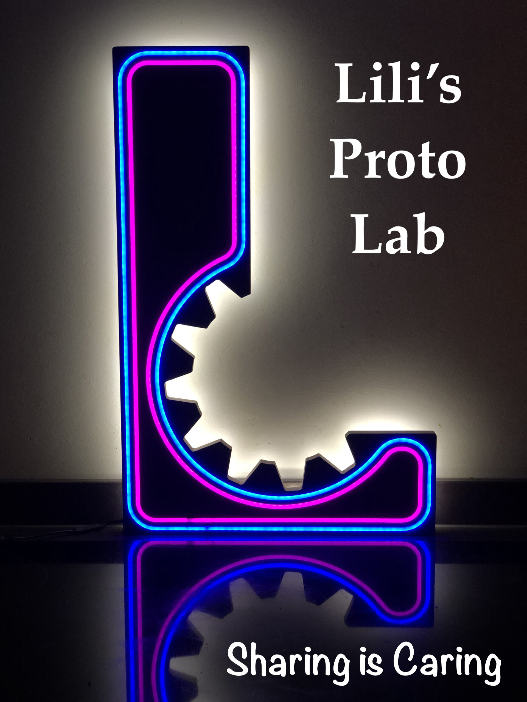

# FunctionalSkin: a bio-inspired passive-cooling façade panel

Rising global temperatures make urban heat stress an increasing problem, and buildings are part of it: façades and roofs absorb solar heat during the day and release it at night (the Urban Heat Island effect). FunctionalSkin is a Major Innovation Project (MSc Bio Inspired Innovation, Utrecht University, supervised by Han Wösten) that investigates a façade cladding panel which passively cools a building and its immediate surroundings, without energy input, using sustainable materials (wood and mycelium).

The project continues earlier work by students of Utrecht University of Applied Sciences (Boer et al., 2025) and the TU/e VirtuE project (Pujadas-Gispert et al., 2020). We added a radiative cooling coating to their convective, faceted panel, built and tested a new prototype, and explored heat-pressed mycelium composites as a future material. This repository collects everything we learned so that others can reuse, repeat or improve it.

## Main features
Three passive cooling strategies in one panel: convection (a 3D folded geometry with 8 cm cavities driving buoyancy-based "chimney" airflow, inspired by termite mounds), plus reflection and radiative cooling (inspired by the Saharan silver ant).
Measured cooling: in a climate chamber (30 °C, 800 W/m² simulated sunlight) the inner back wall reached 64.0 °C unventilated. A flat coated panel brought it to 46.2 °C, our prototype to 39.2 °C, and the prototype with simulated wind (2–4 m/s) to 34.2 °C.
Modular, low-tech prototype: 32 tiles of 15×15 cm in 5.5 mm plywood, CNC-milled, steam-folded to 135° and mounted on a 120×60 cm backboard.
Sustainable materials: a life cycle assessment compared Douglas fir, plywood, thermally modified spruce and mycelium composites. Plywood is a prototyping material only; Douglas fir is the recommended final choice.
Mycelium side project: Fomes inzengae blocks heat-pressed into a 3D shape (not reported before, to our knowledge), with data on pressing parameters, water uptake, contact angle, flexural strength and colour change.
Beyond the lab: business model, IP analysis and implementation plan, plus a TRL assessment (timber panel TRL 4, mycelium TRL 3).
Repository structure

The most important file is this README. Detailed build instructions and results are in the subfolders, each with its own _readme.md.

+ Hardware: everything needed to build the prototypes.
    + Fusion 360 models and CNC toolpaths/G-code for the wooden tiles
    + Aluminium mould for heat-pressing mycelium
    + 3D-printed assembly jig
    + Bill of materials and step-by-step build instructions for the plywood panel, the backboard and the mycelium tiles
+ Documents: general documents.
    + Final report
      + Appendices: cooling mechanisms, material selection, design selection, LCA, business model, IP analysis, implementation plan
      + Expert meeting summaries and literature
      + Results: the prototypes in action and the experimental data.
      + Rectangular shaft experiments (8 configurations)
      + Climate chamber experiments on the prototype
      + Mycelium tests (white value, contact angle, water absorption, flexural strength)
+ Software: the R scripts used to merge, resample (10 s grid), phase-segment and analyse the sensor data, and the Fusion 360 CAM setup that generated the G-code.

## Build instructions

Suggested order for browsing and building:

+ Documents → final report (Part A): read the design requirements, material choice and design development to understand why the panel looks the way it does.
+ Hardware → plywood panel:
    + Mill the tiles from 5.5 mm plywood with the three toolpaths: 90° V-bit (mounting angle), flat bit (contour), 45° V-bit (fold groove, leaving about 1 mm of material so the outer veneer stays intact). Spindle speed is 26,000 rpm for the V-bits and 32,000 rpm for the flat bit.
    + Saw a 5 mm strip off each tile at the 45° angle so the tiles connect seamlessly.
    + Moisten the groove and steam it for about 2 minutes, fold to 135°, hold in the 3D-printed jig and glue with polyurethane construction adhesive (clamp 4 hours).
    + Build the backboard from 48×22 mm spruce battens (5 lengthwise, 9 across, 120×60 cm).
    + Glue and nail the tiles (two inverse versions, 16 of each) to the backboard, add 45° slats between inverse tiles and triangular side pieces, and fill seams with acrylic sealant.
    + Paint the outside facets and sides with three layers of radiative cooling paint (CryoPaint®), drying 24 h between layers. Leave the cavity side uncoated.
+ Hardware → mycelium tiles: grow, dry and heat-press the blocks as described in report part B.3 (115 kN, 150 or 190 °C, 5 or 20 min).
+ Results: repeat the shaft and climate chamber experiments and compare against our data.

## Tips from our build:

+ Test heat transfer in a simplified shaft before the complex shape.
+ Prototype the tile joints in PLA first.
+ Plan for more than a full day of labour per 120×60 cm panel.

## Outcomes
+ A plywood prototype panel that lowers the inner back-wall temperature by up to 24.8 °C under natural convection (almost 30 °C with wind) compared to an unventilated wall in a 30 °C climate chamber.
+ A 7.0 °C improvement over a flat panel with the same coating, showing the effect of the 3D geometry.
+ Evidence from the shaft experiments that a deeper cavity (16 cm vs 8 cm) and a thicker cladding lower the back-wall temperature further.
+ A life cycle assessment comparing wood types and mycelium composites, with the lifespan mycelium would need to match Douglas fir (28–42 years).
+ A proof of concept for heat-pressing cubic mycelium blocks into a 3D shape, with data on pressing parameters and material properties.
+ A business model, IP analysis, implementation plan and TRL roadmap.

## Next steps:

+ Test outdoors and over the seasons.
+ Use larger tiles (e.g. 30×30 cm) so that solid Douglas fir can replace plywood.
+ Simplify the geometry, and press into a mould instead of milling and steaming to scale up.
+ Grow mycelium directly in 3D shapes and develop a bio-based coating.
+ Address fire safety, as the chimney structure could spread fire.

## Team

Project case Owner: Jaco Appelman

Supervisor: Han Wösten & Pauline Krijgsheld

Contributors: Alexandra Cooke-Kasyanto, Felipe Krebs, Ruben Langendoen, Jochem ten Pas @jochemtenpas , Ocker Hazelbag @ockerhazelbag

External experts who advised us: Joris Remmers (TU Eindhoven), Peter Oei, Willem Böttger (NPSP), Pieter Kooijman and Nico van Hijningen (Lili's Proto Lab), Jordi Pelkmans (Utrecht University), Steve Szell, Fran Ortega Exposito (Avans Hogeschool / MNEXT), Naud van der Padt (Leafy), Maud Kerstholt (Netherlands Patent Office) and Arne Hendriks.

## Get involved

We welcome feedback, questions and improvements.

Where to start: read the final report in Documents, then follow the build instructions above.
Issues: open an issue for questions, bugs in the documentation or suggestions. Please describe what you tried, the materials and settings you used, and what you observed.
Pull requests: send a pull request with fixes, new test data or documented design variations.
Direct contact: J.H.Appelman@uu.nl

## License

This project is released under CC0 1.0 Universal. You can modify and reuse it as you like. The project team appreciates your suggestions or examples for enhancing the repository.

## How to cite

unctionalSkin team (2026). FunctionalSkin: a bio-inspired passive-cooling façade panel. Major Innovation Project, MSc Bio Inspired Innovation, Utrecht University.

## Acknowledgments

We thank Lili's Proto Lab, the Utrecht University fungal lab and Utrecht University of Applied Sciences (including the Applied Sciences climate chamber), for access to their facilities and expertise.

  
  <figcaption>Figure: LPL shop front with current and future letters<figcaption>

